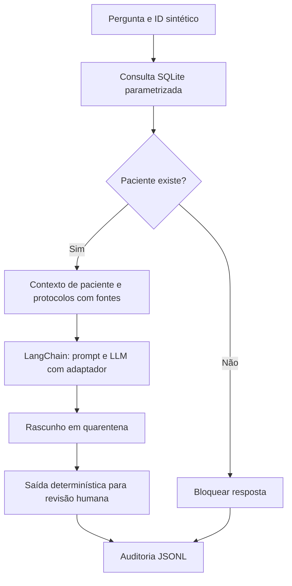

# Relatório técnico - Assistente hospitalar acadêmico

Autores: preencher. Instituição: FIAP. Fase 3.

## Objetivo e escopo

Demonstrar personalização de LLM com dados sintéticos e integração a registros estruturados. O protótipo cobre fluxos de exames pendentes, modelos de laudos/receitas, procedimentos e alertas, sem produzir prescrição ou diagnóstico. Protocolos SYN são fictícios e não foram validados por hospital.

## Dados e preparação

Seis protocolos, dez perguntas por protocolo, respostas supervisionadas e dois prontuários artificiais. Normalização de espaços, substituição demonstrativa de CPF/email/nome rotulado e verificação de perguntas duplicadas. A anonimização por regex é insuficiente para dados reais. Partição por protocolo: SYN-001 a 004 para treino; SYN-005 para validação; SYN-006 para teste. Isso evita vazamento de paráfrases entre partições, mas introduz diferença temática e uma estimativa de generalização muito instável.

## Fine-tuning

Qwen2.5-0.5B-Instruct, escolhido pelo tamanho reduzido para demonstração em GPU do Colab; não é especializado nem validado para medicina. QLoRA com pesos NF4 de 4 bits, LoRA r=8, alpha=16, dropout=0,05 nas projeções q/v. Três épocas, learning rate 2e-4, sequência de 384 tokens, batch 1 e acumulação 4; seed 42. SFT sobre toda a sequência (prompt e resposta). O adaptador é salvo separadamente. Os parâmetros devem ser revistos após examinar a curva de loss.

## Arquitetura e fluxo

O estado LangGraph contém paciente, contexto, rascunho, fontes e status. O corpus inteiro é incluído por ser pequeno; não há banco vetorial. Dados do paciente são obtidos a cada chamada, com timestamp visível. A identificação das fontes demonstra proveniência dos dados, não explica internamente os pesos nem garante fidelidade do rascunho.

## Segurança e rastreabilidade

Sem ferramentas de prescrição, sem execução clínica e sem envio de alertas a terceiros. O texto gerado não passa diretamente ao usuário. Estado final awaiting_human_review não equivale a aprovação humana implementada: a aprovação ocorre fora do protótipo. Logs minimizam conteúdo livre e registram trace, horário UTC, ID fictício, hash, fontes, modelo e status. Não são imutáveis nem constituem trilha certificada.

## Avaliação e resultados

Preencher após executar o Colab:

| Evidência | Resultado observado |
|---|---|
| GPU e versões instaladas | Pendente de execução |
| Loss teste do modelo base | Pendente: outputs/training_metrics.json |
| Loss teste após ajuste | Pendente: outputs/training_metrics.json |
| Curva de treino e validação | Pendente de execução |
| Paciente com/sem alerta | Pendente de execução do grafo real |
| ID inexistente e tentativa de prescrição | Pendente de execução do grafo real |
| Inspeção de fontes e logs | Pendente de execução |

Comparar rascunhos base e ajustado em perguntas idênticas (célula própria), julgando aderência ao contexto, invenção, fontes e recusa a prescrição. O teste de saída determinística verifica o gate, não a segurança da LLM. Queda de loss em dez exemplos sintéticos não prova melhora clínica. Não foram executados treinamento ou inferência GPU durante a preparação local.

## Limitações e próximos experimentos

Ampliar a diversidade do corpus com curadoria especializada, avaliar por casos independentes, medir citações corretas e factualidade com revisores, testar ataques de prompt e implementar autenticação/autorizações antes de qualquer aplicação real. Templates de receita e laudo são exemplos textuais, sem geração de documentos assinados. A consulta pergunta-resposta final é deliberadamente limitada a fatos estruturados; rascunhos clínicos ficam apenas para análise acadêmica.

## Roteiro do vídeo (máximo 15 min)

0–2 min: objetivo, dados e limites; 2–5: preparação e fine-tuning executado; 5–8: métricas e comparação base/ajustado; 8–12: execução de LangChain/LangGraph, alerta e paciente inexistente; 12–14: fontes, logs, revisão humana e limitações. Mostrar resultados efetivamente produzidos.

## Referências

- https://huggingface.co/docs/trl/v0.21.0/sft_trainer
- https://huggingface.co/Qwen/Qwen2.5-0.5B-Instruct
- https://reference.langchain.com/python/langgraph/graph/state
- Enunciado: 8IADT - Fase 3 - Tech challenge.pdf.
